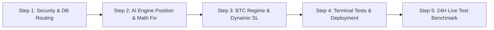

# 📋 Trading Cloudi — Master Problem, Implementation & 24H Live Test Register

**Document Version:** 2.0.0  
**Audit & Implementation Date:** 2026-11-08  
**24-Hour Live Test Validation Date:** 2026-11-09 (20:30 BDT)  
**System:** Trading Cloudi (Unified Binance Demo Futures Guardian & AI Trader)  
**Target Environment:** Binance Demo Futures (`https://demo-fapi.binance.com`) + Render Cloud + Neon PostgreSQL  
**Mode:** REGISTER & IMPLEMENTATION ROADMAP (Terminal Execution)  

---

## 📊 1. Baseline Performance & Current Loss Status (2026-11-08 20:15 BDT)

| Metric | Current Value | Assessment |
| :--- | :--- | :--- |
| **Total Recorded Positions** | 19 | Cloud Neon DB |
| **Active Open Positions** | 3 (`ICNTUSDT`, `THEUSDT`, `FLUIDUSDT`) | Active risk exposure |
| **Closed Trades** | 16 | 2 Wins / 14 Losses |
| **Win Rate** | **12.5%** | **CRITICAL FAILURE** |
| **Net Realized PnL** | **-$170.66 USDT** | Drawdown on $5,000 capital |
| **Dominant Direction** | 17 LONG / 2 SHORT (89.5% Long) | Severe Long Bias during market pullbacks |

---

## 🛑 2. Master Problem Register (Identified & Verified)

### Priority P0: Trading Engine & Direct Loss Drivers

| ID | Title & Component | Severity | Description & Root Cause | Verified Proof |
| :--- | :--- | :--- | :--- | :--- |
| **PRB-LOSS-01** | **Double-Entry & Falling Knife Stacking**<br>`app/ai_engine.py` | **CRITICAL** | `get_recent_ai_symbols()` only checks `entry_ms >= 1h`. It fails to check `status IN ('OPEN', 'EMERGENCY_UNPROTECTED')`. Result: When a trade is already open and in loss, AI re-enters the same coin, doubling risk into a dump. | Trade #16 (`CLANKER` LONG @ 17.46) was open; Trade #17 (`CLANKER` LONG @ 17.99) was opened 2.5h later on the same coin. |
| **PRB-LOSS-02** | **Mathematical Error: EMA 50 on 20 Bars**<br>`app/ai_engine.py#L225-232` | **CRITICAL** | `pd.read_sql_query("... LIMIT 20")` pulls only 20 candles (5 hours), then runs `ewm(span=50)`. Span 50 mathematically requires 150-200 bars to converge. On 20 bars, EMA 50 is invalid noise, causing AI to hallucinate false "Bullish Trends". | Direct code inspection of `app/ai_engine.py` line 225 & 232. |
| **PRB-LOSS-03** | **Blind Long Bias & Missing BTC Regime Filter**<br>`app/ai_engine.py` | **CRITICAL** | 89.5% of trades were LONG. Altcoins dump when Bitcoin pulls back. AI has ZERO visibility into BTC 1h/4h trend or higher-timeframe market structure. It buys 15m micro-wicks into macro dumps. | 14 out of 16 closed trades hit Stop Loss. 17 of 19 total trades were LONG. |
| **PRB-LOSS-04** | **Fixed 7.5% Stop Loss on High-Beta Memecoins**<br>`app/ai_engine.py#L323-339` | **CRITICAL** | AI uses fixed $200 notional with fixed $15 SL ($15 / $200 = 7.5% price distance). High-beta memecoins (`SIGN`, `CLANKER`, `AVAAI`) have 15m ATR wicks of 8-12%, guaranteeing premature SL hits on normal volatility. | Trades #10, #11, #12, #13, #16, #17, #19, #20 all triggered SL before any continuation. |
| **PRB-LOSS-05** | **Binance One-Way Mode `closePosition: true` Collision**<br>`app/demo_client.py` & `app/trade_engine.py` | **HIGH** | Orders submit `closePosition: true`. In Binance One-Way mode, multiple entries merge into one position. When SL triggers, it liquidates the entire merged position, and `close_row()` assigns the total loss to BOTH individual database rows. | Trades #16 and #17 both recorded -$36.28 and -$36.08 (double counted against $15 risk). |
| **PRB-LOSS-06** | **Unsynchronized Dual Engine Double-Ordering**<br>`run_unified.py#L170-185` | **HIGH** | `Engine` (Rule-based) and `AIEngine` run simultaneously at :25s and :35s without inter-engine lock. Both engines can buy the same symbol at the exact same candle close. | Trades #2 (AI) and #3 (RULE) both bought `JTOUSDT` at 11-05 03:15. |

---

### Priority P1: Infrastructure, Database & Stability Hazards

| ID | Title & Component | Severity | Description & Root Cause | Verified Proof |
| :--- | :--- | :--- | :--- | :--- |
| **PRB-SEC-01** | **Exposed Neon DB Credentials in Git History**<br>`app/db.py` | **CRITICAL** | Git commit `74b64da` embedded plaintext Neon URI with password. Working tree patch removes fallback and adds fail-closed handling, but remote Git history is exposed. | `git log -p 74b64da` reveals master credentials. |
| **PRB-DAT-01** | **Dual Database Split-Brain Query Leaks**<br>`app/notifier.py`, `app_ui.py` | **HIGH** | `notifier.py` queries Postgres for SQLite-only `ranking` (Telegram report drops 🏆 Hourly Top). `app_ui.py` queries Postgres for SQLite `premium`. `app_ui.py` queries SQLite for Postgres `signals` (stuck on "idle"). | Live Telegram 07:16 PM report omitted Hourly Top ranking; Dashboard /api/positions swallowed `UndefinedTable`. |
| **PRB-DAT-02** | **Synthetic `sqlite_master` Injected into Postgres**<br>Neon DB | **HIGH** | A dummy `sqlite_master` table was injected into Neon PostgreSQL to bandage SQLite queries like `SELECT 1 FROM sqlite_master WHERE ...` executed against Postgres. | Live Neon inspection shows `public.sqlite_master` table with 4 rows. |
| **PRB-NET-01** | **Socket Timeout Dropped in `_force_ipv4`**<br>`app/demo_client.py#L13-20` | **HIGH** | Monkey-patch ignores `*args` and `**kwargs`, dropping the `timeout` parameter and causing 20-40s TCP hangs on packet drop. | Code inspection confirms `sock.connect(sa)` runs with no timeout set. |
| **PRB-OPS-01** | **Missing Dependencies in Local `.venv`**<br>`.venv`, `start.bat` | **HIGH** | Local `.venv` is missing `psycopg2-binary` and `google-genai`. Launching `start.bat` fails immediately on import. | `.\.venv\Scripts\python.exe -c "import psycopg2"` yields `ModuleNotFoundError`. |
| **PRB-QA-01** | **Zero Automated Test Coverage on Master**<br>`tests/` | **HIGH** | `tests/` directory contains 0 `.py` test files. Running `pytest` discovers 0 items. | `pytest` exits with code 1, `collected 0 items`. |

---

## 🛠️ 3. Implementation Plan (Scheduled for Today: 2026-11-08)

All fixes will be applied via the **terminal** in modular steps:



### Step 1: Security & Database Routing Fixes
1. Commit unstaged [`app/db.py`](file:///e:/TRADING%20WITH%20CLOUDI/app/db.py) (fail-closed + credential sanitization).
2. Fix [`app/notifier.py`](file:///e:/TRADING%20WITH%20CLOUDI/app/notifier.py): Route `positions` to `get_db()` (Postgres) and `ranking` to `market_db()` (SQLite).
3. Fix [`app_ui.py`](file:///e:/TRADING%20WITH%20CLOUDI/app_ui.py): Route `premium` to `market_db()` and `signals` to `db()`.
4. Add native `has_table(con, name)` that checks `information_schema.tables` on Postgres and `sqlite_master` on SQLite.

### Step 2: Trading Engine & Loss Prevention Fixes
1. **Fix Open Position Exclusion:** In [`app/ai_engine.py`](file:///e:/TRADING%20WITH%20CLOUDI/app/ai_engine.py), query `SELECT symbol FROM positions WHERE status IN ('OPEN', 'EMERGENCY_UNPROTECTED')` and completely exclude currently open coins from candidate evaluation.
2. **Fix EMA Mathematics:** In [`app/ai_engine.py`](file:///e:/TRADING%20WITH%20CLOUDI/app/ai_engine.py), fetch 150 candles (`LIMIT 150`) instead of 20, ensuring EMA20 and EMA50 are mathematically accurate.
3. **Fix Network Hangs:** In [`app/demo_client.py`](file:///e:/TRADING%20WITH%20CLOUDI/app/demo_client.py), capture `timeout` in `_force_ipv4` and call `sock.settimeout(timeout)`.
4. **Synchronize Engines:** Ensure `Engine` and `AIEngine` share active symbol lock to prevent simultaneous double-entries.

### Step 3: Bitcoin Trend Filter & Dynamic ATR Stop-Loss
1. **BTC Market Regime Filter:** Fetch BTCUSDT 1h trend. If BTC is below 1h EMA50 or RSI < 45, disable all Altcoin LONG setups (allow only high-conviction SHORTs or Cash/Wait).
2. **Dynamic Volatility Stops:** Replace fixed 7.5% SL with ATR-based stop loss (`entry - 1.5 * ATR` for LONG, `entry + 1.5 * ATR` for SHORT), ensuring stops accommodate each token's natural volatility.

### Step 4: Environment & Test Harness
1. Install missing `.venv` dependencies:
   ```powershell
   .\.venv\Scripts\pip.exe install psycopg2-binary google-genai pytest
   ```
2. Port unit tests into `tests/test_trading_safety.py` to ensure all filters fail closed.

---

## ⏱️ 4. 24-Hour Live Test Protocol (2026-11-08 20:30 to 2026-11-09 20:30 BDT)

Following implementation and deployment today, the bot will run for a continuous **24-hour test window**. Tomorrow at 20:30 BDT, we will execute the verification suite in the terminal.

### 24-Hour Evaluation Targets

| Evaluation Criteria | Target Metric | Verification Method |
| :--- | :--- | :--- |
| **Double-Entry Prevention** | **0 Duplicate Open Trades** | `SELECT symbol, COUNT(*) FROM positions WHERE status='OPEN' GROUP BY symbol HAVING COUNT(*) > 1` must return 0 rows. |
| **Win Rate Recovery** | **Win Rate >= 50%** | Ratio of TP vs SL over newly opened trades in the 24-hour window. |
| **Max Drawdown Protection** | **No single trade loss > $16.50** | `SELECT MIN(pnl) FROM positions WHERE entry_ms >= <start_ms>` must be >= -$16.50 (enforcing $15 target risk + fees). |
| **Telegram Hourly Report** | **100% Reports include 🏆 Top Ranking** | Verify Telegram hourly message at :16 past each hour. |
| **Dashboard Health** | **Signal Engine status: "ok" (not "idle")** | Verify `/api/health` response JSON. |
| **BTC Regime Gating** | **0 Counter-trend Altcoin Longs** | No Altcoin LONG opened when BTC 1h is in active downtrend. |

---

## 💻 5. Terminal Review Commands (For Tomorrow's 24H Review)

Tomorrow (2026-11-09), run these commands in your PowerShell terminal to audit the 24-hour performance:

```powershell
# 1. Check all trades executed in the last 24 hours
python -c "
import sys; sys.path.insert(0, '.')
from app.db import get_db
import time

now_ms = int(time.time() * 1000)
day_ago_ms = now_ms - 24 * 3600 * 1000

con = get_db()
rows = con.execute('SELECT id, time, symbol, side, status, pnl, fee, result, engine FROM positions WHERE entry_ms >= ? ORDER BY id ASC', (day_ago_ms,)).fetchall()
print(f'Trades in last 24H: {len(rows)}')
for r in rows:
    print(r)
con.close()
"

# 2. Check 24H Win/Loss & Net PnL Summary
python -c "
import sys; sys.path.insert(0, '.')
from app.db import get_db
import time

day_ago_ms = int(time.time() * 1000) - 24 * 3600 * 1000
con = get_db()
rows = con.execute('SELECT pnl, fee, result FROM positions WHERE status=\"CLOSED\" AND entry_ms >= ?', (day_ago_ms,)).fetchall()
trades = len(rows)
wins = sum(1 for r in rows if float(r['pnl'] or 0) > 0)
losses = sum(1 for r in rows if float(r['pnl'] or 0) <= 0)
net_pnl = sum(float(r['pnl'] or 0) for r in rows)
fees = sum(float(r['fee'] or 0) for r in rows)
wr = (wins / trades * 100) if trades else 0.0
print(f'24H Closed: {trades} | Wins: {wins} | Losses: {losses} | Win Rate: {wr:.1f}% | Net PnL: ${net_pnl:.2f} | Fees: ${fees:.2f}')
con.close()
"
```
